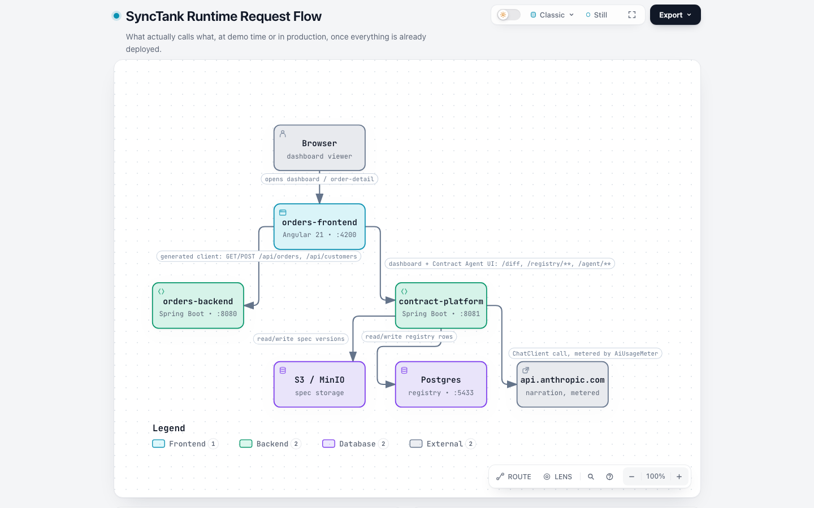
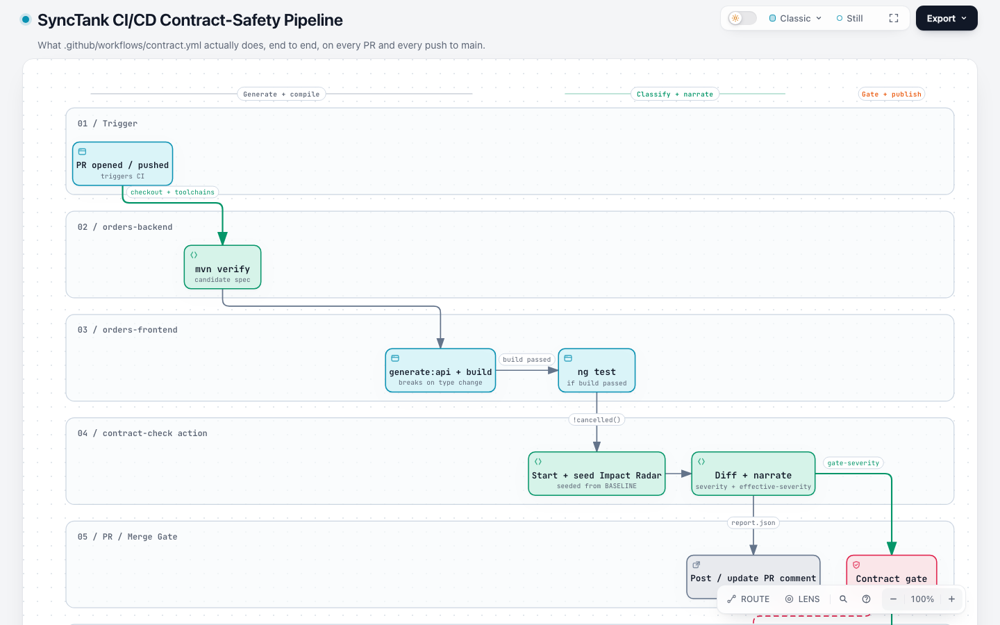
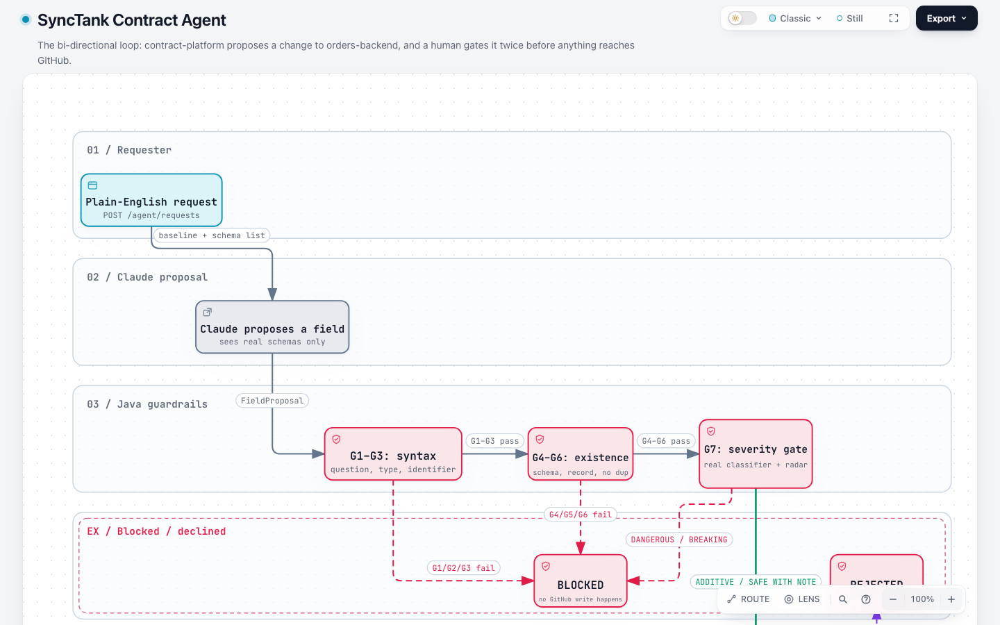
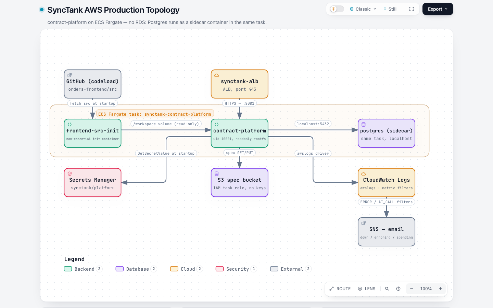
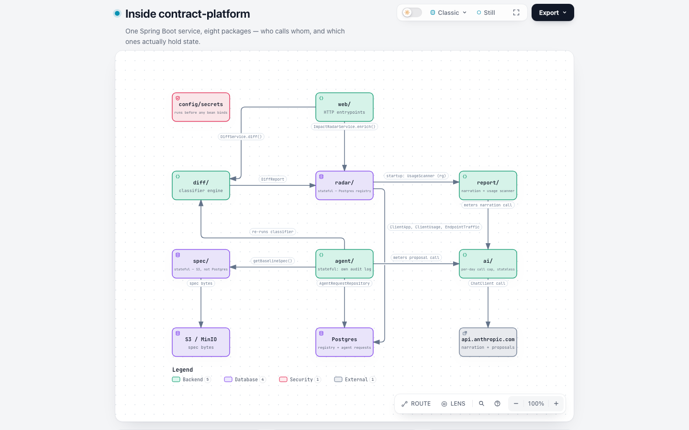

# SyncTank

SyncTank is an API contract-safety pipeline for a toy e-commerce system. It demonstrates how a
backend's OpenAPI contract can be enforced end to end: every pull request diffs a candidate spec
against a committed baseline, classifies the change deterministically, weighs it against the
frontend code that actually consumes it, explains it in plain English, and gates the merge — plus
a bi-directional Contract Agent that can propose safe contract changes back to the backend under
the same guardrails.

## Architecture & request-flow diagrams

Five code-backed diagrams — generated with [Archify](https://skills.sh/tt-a1i/archify) straight
from this repository's source — walk through the system end to end: the runtime request flow, the
CI/CD contract-safety pipeline, the Contract Agent's two-human-gate loop, the AWS production
topology, and `contract-platform`'s internal package map.

**Live, interactive version:** **[jgantayat.github.io/synctank/architecture-flow.html](https://jgantayat.github.io/synctank/architecture-flow.html)**
— each panel has hoverable source citations back to the exact file and line, and live motion along
the connectors.

> GitHub strips `<iframe>`/`<script>` from rendered Markdown, so the interactive version can only
> be viewed on the page above, not inside this README. The previews below are static screenshots of
> each panel — click any of them to open the real, interactive one.

<table>
<tr>
<td width="50%">

**1 · Runtime Request Flow**
[](https://jgantayat.github.io/synctank/architecture-flow.html)

</td>
<td width="50%">

**2 · CI/CD Contract-Safety Pipeline**
[](https://jgantayat.github.io/synctank/architecture-flow.html)

</td>
</tr>
<tr>
<td width="50%">

**3 · Contract Agent Loop**
[](https://jgantayat.github.io/synctank/architecture-flow.html)

</td>
<td width="50%">

**4 · AWS Production Topology**
[](https://jgantayat.github.io/synctank/architecture-flow.html)

</td>
</tr>
<tr>
<td width="50%">

**5 · Inside contract-platform**
[](https://jgantayat.github.io/synctank/architecture-flow.html)

</td>
<td width="50%"></td>
</tr>
</table>

## Modules

This is a monorepo of three independently-buildable modules, wired together only through CI and
HTTP calls at runtime — no shared build, no shared code:

| Module | What it is | Port |
|---|---|---|
| [`orders-backend/`](orders-backend) | Spring Boot 4.1 / Java 21 REST service that owns the `OrderResponse`/`CreateOrderRequest` API. Its generated OpenAPI spec *is* the contract everything else reacts to. | 8080 |
| [`orders-frontend/`](orders-frontend) | Angular 21 app. Its API client (`src/app/generated/`) is entirely code-generated from `orders-backend`'s spec. Also hosts the dashboard that drives the diff/Impact-Radar view and the Contract Agent. | 4200 |
| [`contract-platform/`](contract-platform) | Spring Boot 4.1 / Java 21 service — the system's brain. Stores spec versions (S3/MinIO), diffs baseline vs. candidate and classifies every change as `ADDITIVE`/`DANGEROUS`/`BREAKING`, tracks which frontend screens actually consume which fields (the **Consumer Impact Radar**), narrates diffs via Claude, and runs the bi-directional **Contract Agent**. | 8081 |

Two more directories are operational, not independently-buildable modules:

- [`infra/`](infra) — numbered deploy scripts, ECS task definition and IAM policies for running
  `contract-platform` on AWS, plus a LocalStack rehearsal path for its Secrets Manager mechanism.
- [`demo/`](demo) — scripts that drive the live demo (cloud vs. local target, the compile-break →
  migrate → Impact Radar slide sequence, a second-repo "live adoption" rehearsal). Not used by CI.

## Getting started

```bash
# MinIO (S3-compatible spec storage) + Postgres, for contract-platform
docker compose up -d minio postgres

# orders-backend — REST API (:8080)
cd orders-backend && ./mvnw spring-boot:run

# contract-platform — diff engine, Impact Radar, Contract Agent (:8081)
cd contract-platform && ./mvnw spring-boot:run

# orders-frontend — dashboard + order-detail UI (:4200)
cd orders-frontend && npm ci && npm start
```

`ANTHROPIC_API_KEY` enables Claude narration and Contract Agent proposals; without it, both
degrade gracefully to a deterministic report rather than failing. See each module's own
`CLAUDE.md` for build/test commands and package-level architecture.

## The CI/CD pipeline

On every PR/push to `main` ([`.github/workflows/contract.yml`](.github/workflows/contract.yml)):

1. `orders-backend` generates the candidate OpenAPI spec (`mvn verify`).
2. `orders-frontend` regenerates its API client against that spec and builds — a field whose
   *name* survives but whose *type* changes fails here, at TypeScript compile time, with a file
   and line.
3. The reusable [`contract-check`](.github/actions/contract-check) GitHub Action diffs baseline vs.
   candidate, classifies the change, enriches it against real consumer evidence (the Impact
   Radar), narrates it with Claude, posts one PR comment, and gates the merge on the
   *effective* severity — not the raw classifier verdict.
4. On `main` only, the candidate spec becomes the new committed baseline.

`contract-check` is published as a standalone, reusable action — any repo can adopt the same check
with `uses: jgantayat/synctank/.github/actions/contract-check@v1`
([details](.github/actions/contract-check/README.md)).

## The Contract Agent

`contract-platform` can also propose a contract change *back* into `orders-backend`: given a
plain-English request, it drafts one new additive field, runs it through deterministic guardrails
(type allowlist, identifier shape, schema/record existence, duplicate check, and a full re-run of
the real severity classifier and Impact Radar), and — only on explicit human approval — opens a
GitHub PR with the call sites already stubbed so the build still compiles. Drafting never touches
GitHub; approving is the only method anywhere in the platform that does. See panel 3 above for the
full flow.

## License

No license file is currently included in this repository.
